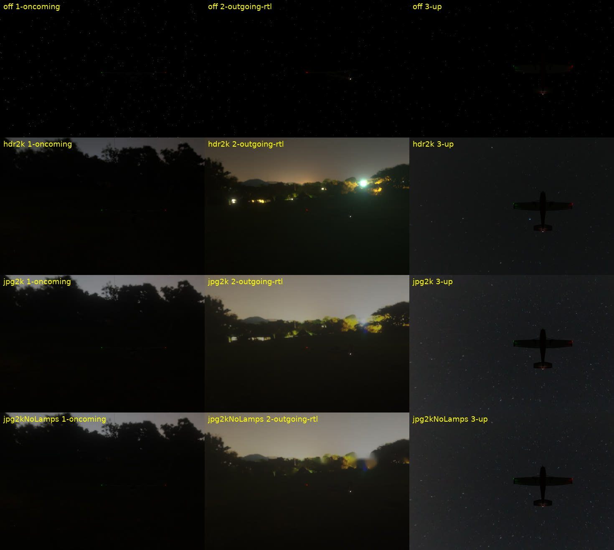
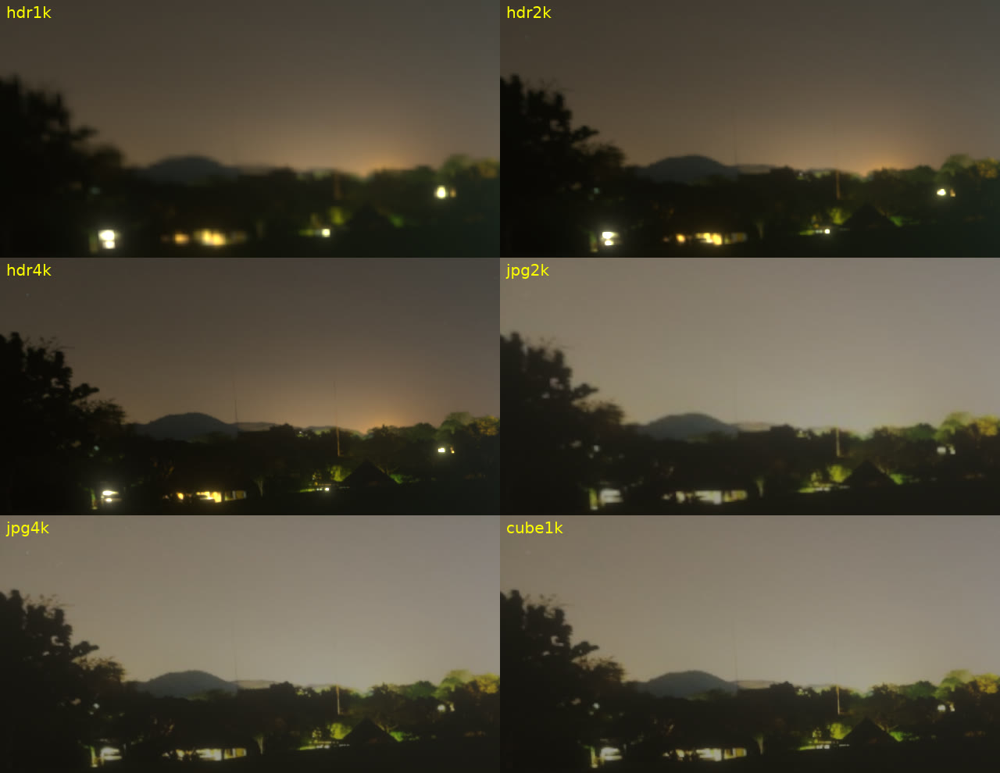
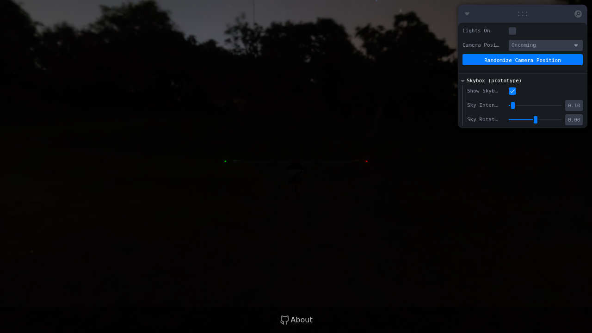
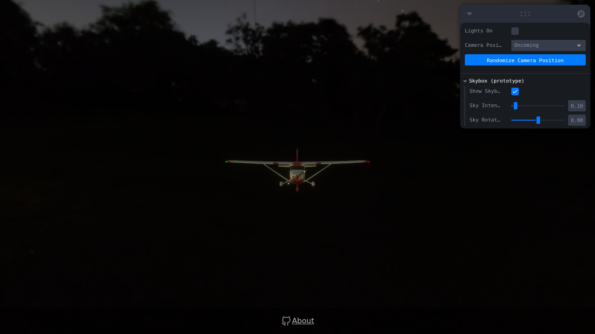

# Skybox prototype: Poly Haven `moonless_golf`

**Should the demo get a photographic skybox? No.** The `moonless_golf` sky costs almost nothing to render, and the 2k JPG costs almost nothing to download. It still makes the demo worse at its one job, which is to make the student read the heading from the position lights alone. Keep `<Stars>` and, if more atmosphere is wanted, add a procedural horizon (see [Alternative](#alternative-instead-of-a-photo-skybox)).

Everything here sits behind URL parameters. **Without `?sky=…` the demo renders exactly as on `main`.**

## How to try it

```bash
pnpm install
pnpm dev   # http://localhost:5173/night-airplane-demo/?sky=jpg2k
```

| Parameter            | Effect                                                                                                                                                  |
| -------------------- | ------------------------------------------------------------------------------------------------------------------------------------------------------- |
| `?sky=<variant>`     | Turns the skybox on (variants below) and hides `<Stars>`. It also adds a "Skybox (prototype)" folder to the leva panel with Show / Intensity / Rotation |
| `?skyIntensity=<n>`  | Starting `backgroundIntensity`. Defaults: 0.1 for HDR, 0.3 for JPG/cube                                                                                 |
| `?skyRotation=<rad>` | Starting Y rotation of the sky                                                                                                                          |
| `?skyIbl`            | Also sets `scene.environment` (image-based lighting). For comparison only                                                                               |
| `?stats`             | Shows `<StatsGl>` and switches `frameloop` to `"always"` so frame times are meaningful                                                                  |

Variants: `hdr1k`, `hdr2k`, `hdr4k` (Radiance .hdr, loaded by drei `<Environment files>`), `jpg2k`, `jpg4k` (ACES tone-mapped, EV −0.5, sRGB JPG, loaded with `useTexture` + `<Environment map>`), `jpg2kNoLamps` (jpg2k with the horizon lamps inpainted by `remove_lamps.py`), and `cube1k` (six 1024² JPG faces).

`moonless_golf_4k.hdr` (26.7 MB) is gitignored. To use `?sky=hdr4k`, fetch it into `public/skybox/moonless_golf/` with Poly Haven's `download.sh` from the asset-prep task, or from https://polyhaven.com/a/moonless_golf.

### How it is wired

- `src/components/ThreeDModel.tsx` reads the parameters once. With `?sky` it renders the lazy `Skybox` component in its own `<Suspense>`, which shows `<Stars>` while the sky downloads, so the plane never waits on the sky to render. Without `?sky` the tree is the same as before. The prototype code is in separate lazy chunks (`Skybox-*.js` is 54 kB, `PerfStats-*.js` is 10 kB). The default bundle grows by 3.9 kB (1.5 kB gzipped), from the parameter parsing and the lazy wrappers.
- `src/components/Skybox.tsx` uses `background="only"`. That sets `scene.background` and never sets `scene.environment`, so the sky adds no light to the plane.
- `three@0.180.0` and `@types/three@0.180.0` are now direct dependencies, pinned to the version that was already in the lockfile. `Skybox.tsx` imports the texture constants from them.

## Screenshots

`screenshots/` has every shot at 1280×720, rendered with SwiftShader in headless Chromium, with "Lights On" off. `comparison.jpg` is the overview. `variants-crop.jpg` crops the same horizon from all six variants.



Rows: off (today), hdr2k, jpg2k, jpg2kNoLamps. Columns: the "Oncoming" preset, an "Outgoing" preset facing the lamps, and looking up at the plane from below.



Environment lighting, with the "Oncoming" preset and the same sky intensity in both shots:

| `?sky=hdr2k` (background only)        | `?sky=hdr2k&skyIbl` (background + IBL)   |
| ------------------------------------- | ---------------------------------------- |
|  |  |

### What the screenshots show

1. **The silhouette gives the heading away.** With the sky off, the dark airframe disappears into black, and only the red, green and white lights are visible. With any sky bright enough to look like more than black, the airframe shows as a dark cut-out wherever it sits in front of the sky. In the "look up" shots (`*_3-up.png`) the whole planform is readable: wings, tail and nose direction. All six presets look at the plane from about 8° above, so in those it sits against the dark ground and trees and mostly stays hidden. A CFI who orbits the camera loses that protection.
2. **The horizon lamps compete with the nav lights.** The clubhouse lamps are bright white and warm dots near the horizon (a white light that the student is meant to find is the tail light). In the HDR variants they blow out and bloom, because the scene is not tone-mapped and the bloom threshold is 0.03. Rotation can't hide them: they span about 170° of horizon, and the two preset groups face opposite ways. Inpainting (`jpg2kNoLamps`) removes the points, but it leaves a smeared glow patch that is easy to spot.
3. **The setting doesn't fit.** The camera sits about 10 units above the ground, looking almost horizontally, so most of the frame is golf-course trees and grass. The plane reads as hovering at tree height in a park rather than flying at night. The Milky Way, the part that would help, is only in view when looking up, and that is where the silhouette problem is worst.
4. **Resolution.** A 2k equirect is about 5.7 px/deg. At fov 50 on 1280 px the screen is about 26 px/deg, so the sky is upscaled about 4.5×. The trees look soft or out of focus, and most stars go below one pixel and vanish. 4k is visibly sharper on the tree line but still soft. 1k is mush. None of the variants showed seams, including the cube faces.
5. **HDR vs LDR.** The scene isn't tone-mapped, so the HDR has to be scaled to about 0.1, and only the lamps stay above 1.0. That gives harsher lamps and nothing else that the tone-mapped JPG at 0.3 doesn't already show. The JPG looks a little greyer and lighter in the sky, and the HDR a little warmer. There is no case for shipping the HDR.
6. **IBL (`?skyIbl`) is a hard no.** At `environmentIntensity` 1 it lights the entire airframe: white fuselage, red trim, struts and gear. The heading is obvious before anyone looks at a light. Any sky has to stay `background="only"`.

## Cost

Measured with `measure.mjs` (headless Chromium, cache disabled, network throttled to 20 Mbit/s with 40 ms latency, 480×270, `?stats` so `frameloop="always"`, 15 s sample, 2 runs per variant). Raw output is in `measurements-swiftshader.jsonl`.

⚠️ **This container only has SwiftShader (CPU WebGL).** Its frame times are dominated by the 8× MSAA composer and bloom, and only differences between rows mean anything. Load times depend on bandwidth and decode, not the GPU, so those numbers are real.

| Variant          |   File size | Transfer¹ | Plane visible² (s) | Sky on screen² (s) |    Δ vs off | Frame time median, SwiftShader (ms) | Est. GPU memory³ |
| ---------------- | ----------: | --------: | -----------------: | -----------------: | ----------: | ----------------------------------: | ---------------: |
| off (today)      |           0 |         0 |               2.42 |                  — |           — |                           283 / 317 |                0 |
| hdr1k            |     1.67 MB |   1.44 MB |               3.17 |               3.20 |      +0.8 s |                           300 / 283 |           ~8 MiB |
| **hdr2k**        |     6.69 MB |   5.80 MB |           **4.35** |               5.65 |  **+3.2 s** |                           317 / 283 |          ~32 MiB |
| hdr4k            |    26.67 MB |  23.24 MB |               4.20 |          **13.00** | **+10.6 s** |                           317 / 283 |         ~128 MiB |
| **jpg2k**        | **0.25 MB** |   0.25 MB |               2.54 |               2.59 | **+0.17 s** |                           300 / 283 |          ~19 MiB |
| jpg2kNoLamps     |     0.24 MB |   0.24 MB |               2.51 |               2.55 |     +0.13 s |                           317 / 283 |          ~19 MiB |
| jpg4k            |     0.99 MB |   0.99 MB |               2.87 |               2.91 |     +0.49 s |                           300 / 283 |          ~75 MiB |
| cube1k (6×1024²) |     0.67 MB |   0.67 MB |               2.67 |               2.71 |     +0.29 s |                           283 / 283 |          ~32 MiB |

¹ `encodedBodySize`. `vite preview` gzips the .hdr. GitHub Pages probably won't, because it serves `.hdr` as `application/octet-stream`, so assume the full file size. For scale, the plane GLB is 4.68 MB and the JS is 410 kB gzipped.
² Mean of the two runs, in ms since navigation start, converted to seconds. "Plane visible" is when the GLB response ends. "Sky on screen" is the `skybox-ready` mark. The sky downloads in parallel with the GLB and competes for bandwidth, so **the HDR variants delay the plane itself**: by about 2 s for hdr2k at 20 Mbit/s.
³ Computed, not measured. It counts the equirect texture plus the cube render target that three.js builds for `scene.background` (face size = height/2, with mipmaps). HDR uses HalfFloat RGBA (8 B/px) and JPG uses RGBA8.

**Frame time:** no difference within noise. Every row is 283–317 ms, which is SwiftShader quantizing frames to 16.7 ms multiples. `renderer.info` is the same in every variant: 34 draw calls per frame (the sky's cube replaces the `<Stars>` points draw), plus 12 triangles. On a real GPU the background is one textured-cube pass, about one texture fetch per pixel, which is expected to cost well under 0.1 ms at 1080p. That figure was not measured here. To measure on real hardware, run `node docs/skybox-prototype/measure.mjs --headed --viewport 1920x1080` against `pnpm preview --port 4173` (it needs `playwright` installed), or open `?stats&sky=jpg2k` and read StatsGl.

**So performance is not the reason for no-go.** The 2k JPG costs 250 kB, +0.2 s and about 19 MiB of GPU memory. The no-go is about what the sky does to the exercise.

## Recommendation

| Question                                     | Answer                                                                                                                                                                                                                                                                                                                                                                                                                                                                                                                                                                                                                                        |
| -------------------------------------------- | --------------------------------------------------------------------------------------------------------------------------------------------------------------------------------------------------------------------------------------------------------------------------------------------------------------------------------------------------------------------------------------------------------------------------------------------------------------------------------------------------------------------------------------------------------------------------------------------------------------------------------------------- |
| **Go / no-go**                               | **No-go** for `moonless_golf`, and for any ground-level photo HDRI, as the demo's sky. It makes the airframe readable as a silhouette, puts bright lamps where the student should only see nav lights, and puts the plane in a park. Leave `?sky` out of `main`, or merge it only as a debug flag that is off by default if you want to keep experimenting.                                                                                                                                                                                                                                                                                   |
| Variant / resolution / format, if overridden | `jpg2k`: tone-mapped sRGB JPG, 2048×1024, 248 kB, `backgroundIntensity` around 0.3, loaded after the plane. HDR adds 6.7–27 MB and delays the plane, with no visible benefit in this untone-mapped scene. 4k is only sharper at 4× the bytes and memory.                                                                                                                                                                                                                                                                                                                                                                                      |
| Environment lighting                         | **No.** Background only (`background="only"`). IBL lights the whole airframe (screenshot above).                                                                                                                                                                                                                                                                                                                                                                                                                                                                                                                                              |
| Productionizing, if overridden               | 1) Ship `jpg2k` (or a KTX2/UASTC or ETC1S 2k equirect through `useKTX2`, with the Basis transcoder self-hosted under `BASE_URL`, which cuts GPU memory to about 4–8 MiB on mobile) from `public/skybox/` on Pages. No LFS is needed. 2) Start the sky download only after the GLB has finished, so it never competes with the plane. 3) Make it a CFI-facing leva toggle, off by default, rather than a URL parameter. 4) Inpaint or crop the horizon lamps properly, or darken the lower hemisphere. 5) Clamp `backgroundIntensity` so the plane's silhouette stays below a contrast threshold, and check it from all presets plus orbiting. |
| Alternative                                  | **Keep the procedural `<Stars>`** (0 bytes, already there). For more realism at zero download: (a) a dark gradient sky dome or `shaderMaterial` sphere, near-black at the zenith and a faint dark-blue or grey glow at the horizon, to give a horizon reference without a readable silhouette; (b) tune `<Stars>` with fewer, varied-size stars and `saturation` about 0.1, and drop `speed` motion; (c) if a photo sky is still wanted, use a **stars-only** sky (Milky Way, no ground, no lamps) with the lower hemisphere black, as a 1k–2k KTX2 cube, background only.                                                                    |

**Bottom line: it isn't worth it.** The render and download cost of the JPG variant is negligible. The visual change works against what the demo teaches.

## Files

- `measure.mjs`: frame-time and load-time harness (Playwright).
- `remove_lamps.py`: builds `moonless_golf_2k_ev-0.5_nolamps.jpg`.
- `measurements-swiftshader.jsonl`: raw results.
- `screenshots/`, `comparison.jpg`, `variants-crop.jpg`: visuals.
- Assets in `public/skybox/moonless_golf/` are Poly Haven `moonless_golf` by Greg Zaal, CC0 1.0.
